# coils-for-new-landreman

Coils, optimized with [ESSOS](https://github.com/uwplasma/ESSOS), for the exact 3-D MHD equilibria of
[Landreman, arXiv:2609.26742](https://arxiv.org/abs/2609.26742) and their non-stellarator-symmetric
extensions ([Issan et al., arXiv:2610.07304](https://arxiv.org/abs/2610.07304)), checked by field-line
tracing, free-boundary VMEX and alpha-particle losses.

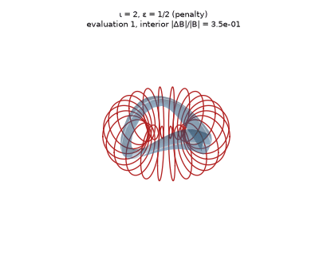 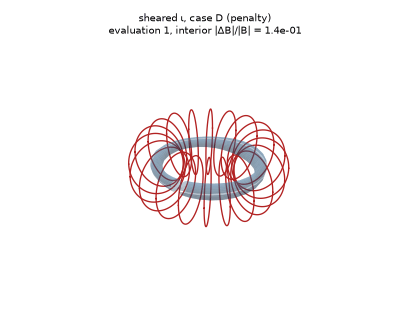

## Results

- **Coils hold the exact field.** Cases D and E: boundary B·n/|B| below 7e-4, field lines within 2 mm of
  the exact surfaces, no islands.
- **Free-boundary VMEX** with only the coils lands within 3-4 mm of the exact boundary, ι within 0.5 %.
- **The equilibria are ideal-MHD unstable**: 6-8 unstable directions, decay index 2.4-9.5.
- **Without stellarator symmetry** the same pipeline works unchanged (ESSOS, virtual casing); the
  mirror pair is reproduced to every printed digit.

| case | interior \|ΔB\|/\|B\| mean / max | boundary B·n/\|B\| mean / max | field lines, mean / max | free-boundary VMEX, mean / max |
| --- | --- | --- | --- | --- |
| ι = 2 | 8.7e-5 / 2.7e-4 | 1.7e-4 / 4.8e-3 | closed lines | not converged (ι rational) |
| sheared A | 4.8e-4 / 1.5e-3 | 1.8e-3 / 6.1e-3 | 3.95 / 25.8 mm | 3.9 / 11.4 mm |
| sheared D | 6.2e-5 / 1.5e-4 | 1.9e-4 / 7.0e-4 | 0.63 / 2.29 mm | 3.0 / 6.4 mm |
| sheared E | 4.1e-5 / 8.5e-5 | 1.3e-4 / 4.8e-4 | 0.57 / 1.98 mm | 2.6 / 4.9 mm |
| ι = 2, τ = ±0.5 | 7.3e-5 / 2.5e-4 | 1.4e-4 / 6.0e-4 | — | not converged (ι rational) |
| sheared, τ = ±0.4 | 1.0e-4 / 5.6e-4 | 3.8e-4 / 3.2e-3 | — | not converged (resolution) |

*Penalty method, 6 coils per half period (12 per period without symmetry), order 6, length ≤ 4.5 m,
curvature ≤ 5 m⁻¹, total curvature ≤ 5π.*

### Coils

| ι = 2 | sheared A |
| --- | --- |
| 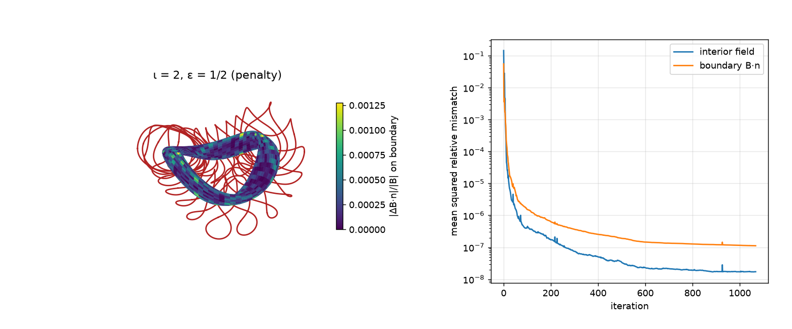 | 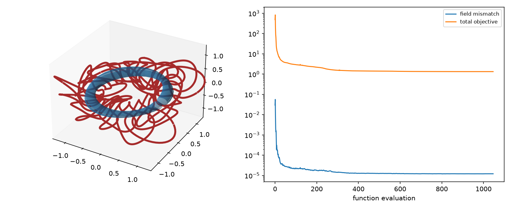 |
| **sheared D** | **sheared E** |
| 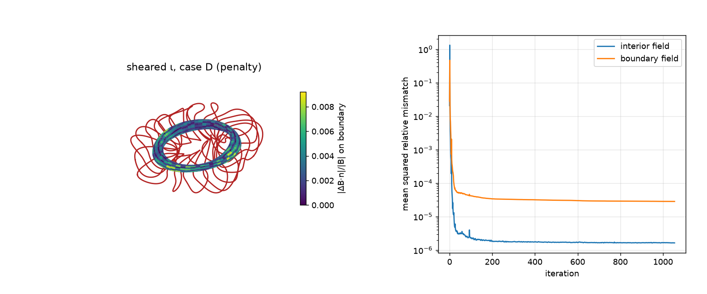 | 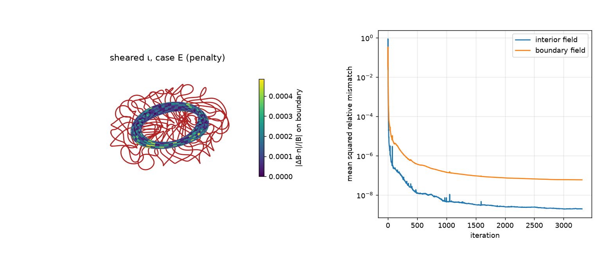 |

*Coils on the boundary coloured by B·n error, with convergence. For ι = 2 a 6.5 % error remains at a few
inboard points where |B| peaks, for every coil set tried.*

### Field lines and free-boundary VMEX

| | |
| --- | --- |
| 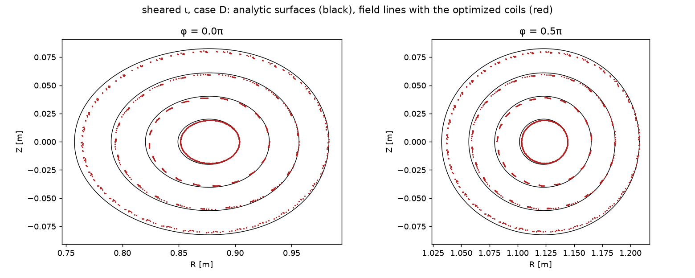 | 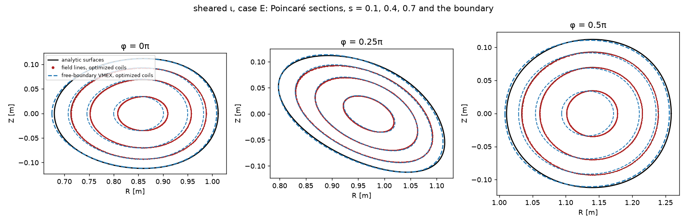 |

*Black: exact surfaces. Red: field lines with the coils. Blue dashed: free-boundary VMEX with the same coils.*

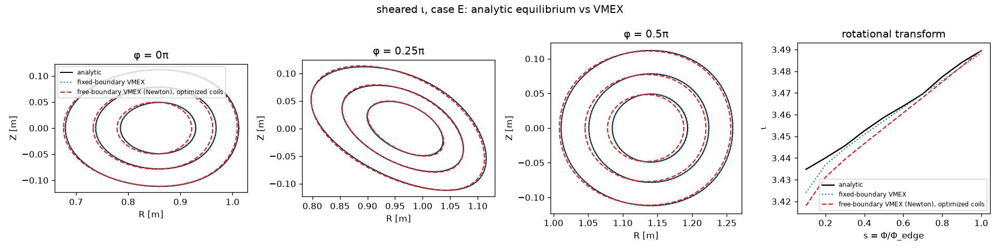

*Free boundary converges by Newton (|F| ≈ 2e-13). Descent cannot settle these equilibria: they are unstable,
and Newton reports the unstable directions. [vmex#570](https://github.com/uwplasma/vmex/pull/570) adds
position control.*

### `vmex --plot` and alpha losses on the free-boundary equilibrium

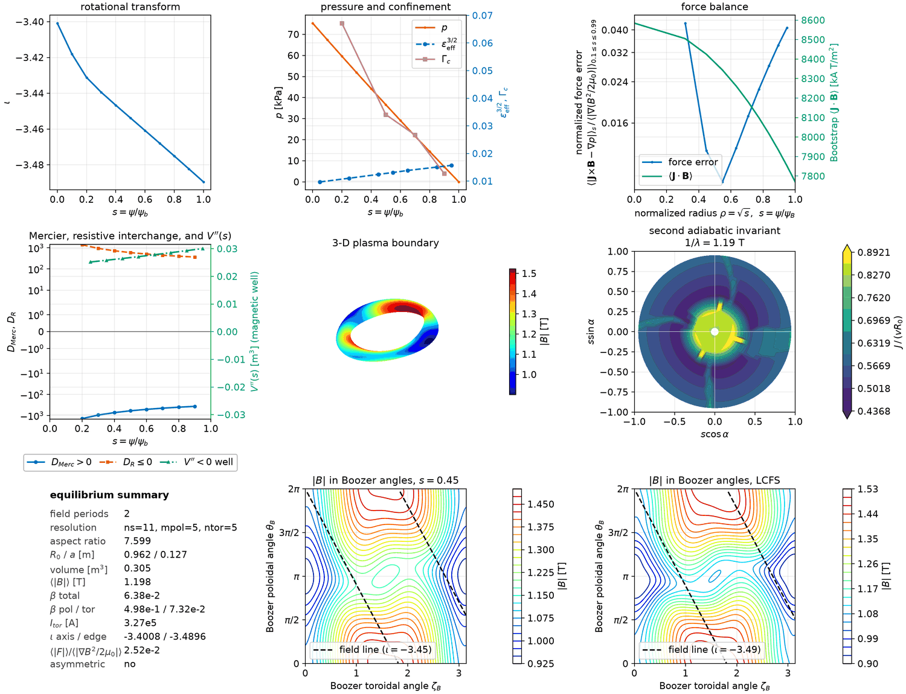

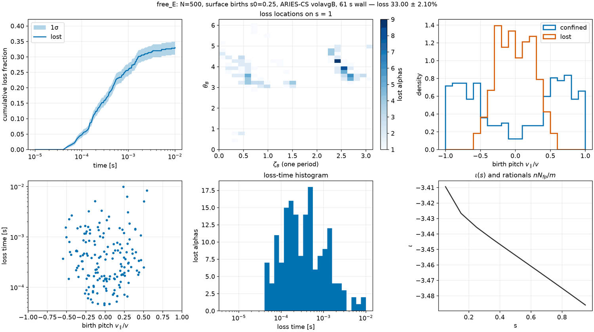

*Case E held by the coils, scaled to ARIES-CS size: 32.8 ± 2.1 % of 500 alphas from s = 0.25 are lost in
10 ms, almost all deeply trapped (|v∥/v| < 0.5), mostly within 3 ms, concentrated at two helical stripes per
period. Energy is conserved to 1e-4.*

### Without stellarator symmetry

| ι = 2, τ = 0.5 | sheared, τ = 0.4 |
| --- | --- |
| 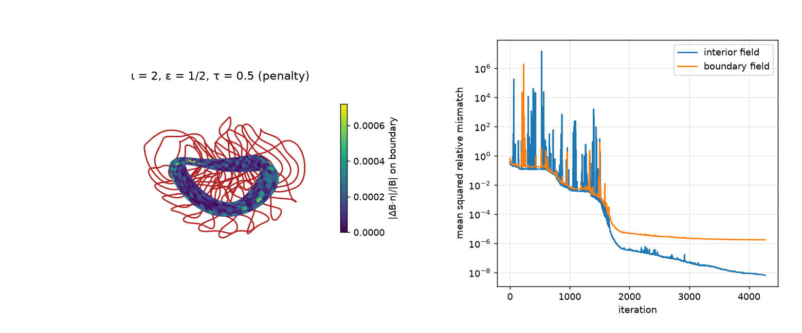 | 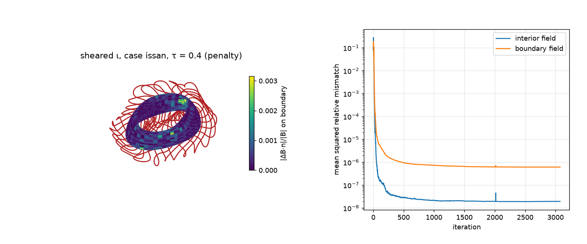 |

- **Mirror check.** The τ coils, rotated by π about x with currents reversed, give the τ error on the −τ
  target to every printed digit. Independently optimized −τ coils reach the same error with a different
  shape.
- **Free boundary does not converge, and not because of the asymmetry.** The symmetric ι = 2 case fails the
  same way with and without `LASYM`, and case D forced through `LASYM = T` still converges to 2e-13. Constant
  rational ι = 2 is the obstacle; the sheared τ case needs more modes than the dense Newton solve allows.
- **Vacuum.** Neither family has a zero-pressure member, so the coils match the finite-β exterior field;
  p = 0 at fixed current moves the boundary 1-3 cm.

## Parameter scans

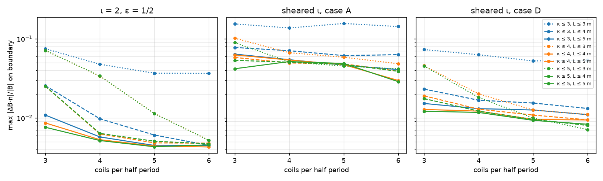

*Maximum boundary B·n error against coil count, curvature and length (108 runs). 5 coils per half period
are within 1.24x of 6; 4 m length and 4 m⁻¹ curvature are enough. Loop cap: [scan_loop_cap.png](scan_loop_cap.png).*

Augmented Lagrangian (`*_augmented_lagrangian.py`) meets every limit exactly and matches the penalty error,
at 5-14x the cost.

## Method

- **Target.** The coils reproduce B_coils = B − B_plasma. Inside the plasma, virtual casing of the exact
  boundary field gives it to 2e-15 (sheared) and 1.4e-8 (ι = 2); on the boundary,
  [virtual_casing_jax](https://github.com/uwplasma/virtual_casing_jax)'s singular quadrature gives all
  three components to 1e-6.
- **Objective.** Interior field plus the full boundary field (normal part for B·n = 0, tangential part for
  pressure balance), with length, curvature, total curvature, spacing and linking limits. Exact JAX gradients,
  L-BFGS-B.
- **Cases** (scaled to 1 m and 1 T): ι = 2 (paper fig. 1); sheared A (paper fig. 2); D and E, new parameters
  that keep the singular foci of the sheared family out of the plasma; the τ cases follow
  [vmex-benchmark-analytical](https://github.com/rogeriojorge/vmex-benchmark-analytical).

## Usage

```bash
pip install -r requirements.txt
python optimize_coils_iota2.py [iota2_tau]           # about 10 min each
python optimize_coils_sheared_iota.py [A|D|E|issan_tau]
python check_tau_coils.py                            # fine-target errors and mirror check
python benchmark_vmex.py [cases]                     # fixed- and free-boundary VMEX
python validate_fieldlines.py                        # Poincare sections (about 1.5 h)
python scan_coils.py                                 # scans (about 1.5 h)
vmex wout_free_E.nc --plot --trace                   # summary and alpha losses
pytest -q                                            # exact checks of every equilibrium
```

Peak memory is about 10 GB; run one script at a time on a 24 GB machine.

## Upstream fixes

[virtual_casing_jax#19](https://github.com/uwplasma/virtual_casing_jax/pull/19) (left-handed grids, 2500x
error) and [#21](https://github.com/uwplasma/virtual_casing_jax/pull/21) (no stellarator symmetry);
[ESSOS#147](https://github.com/uwplasma/ESSOS/pull/147) (augmented-Lagrangian inner iterations);
[vmex#571](https://github.com/uwplasma/vmex/pull/571) (wrong-sign PHIEDGE) and
[#570](https://github.com/uwplasma/vmex/pull/570) (position control).
